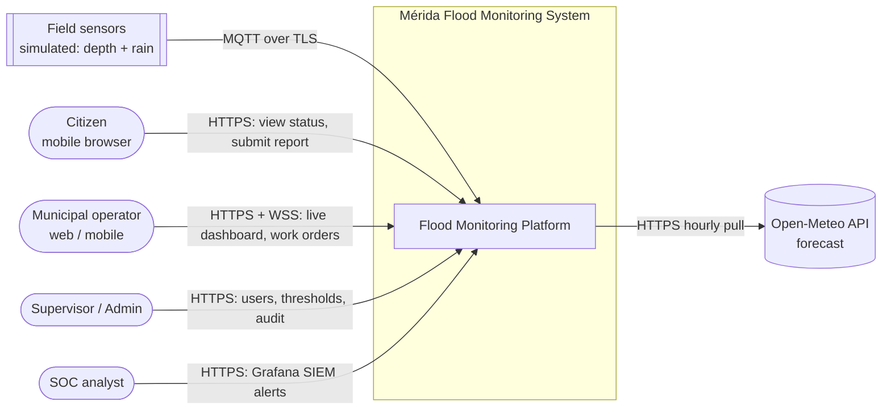
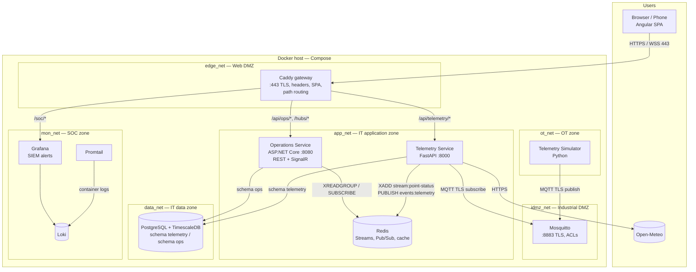
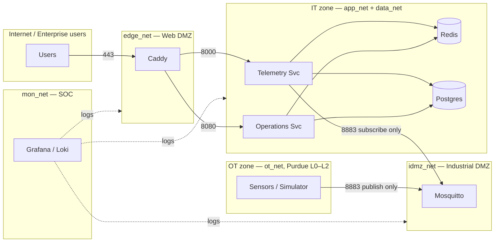
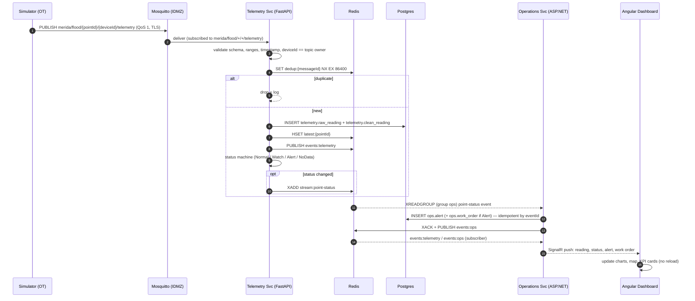
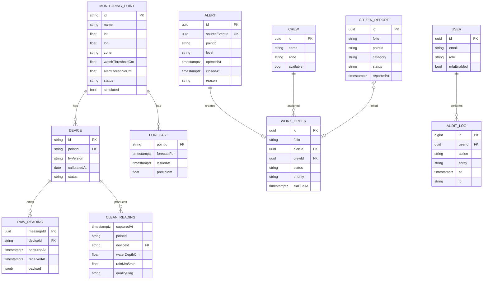
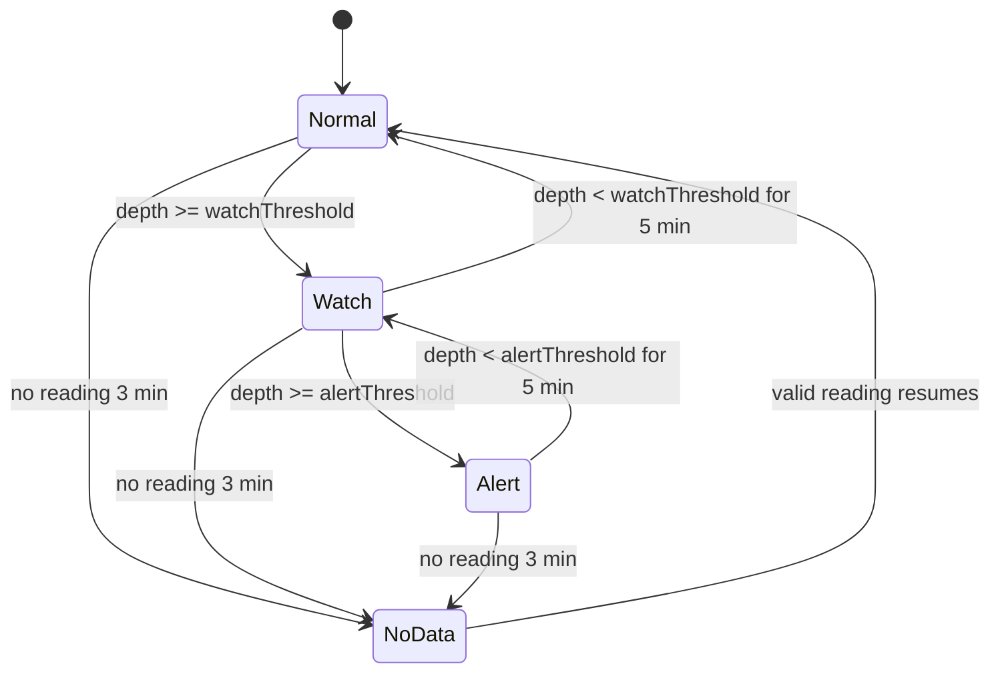
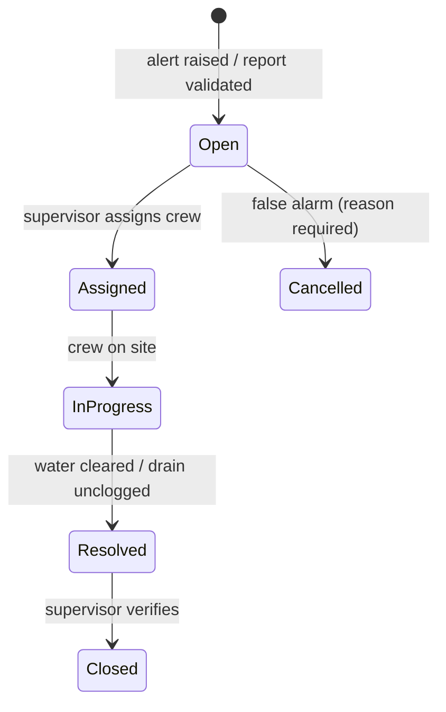
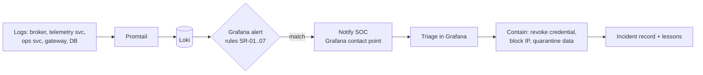
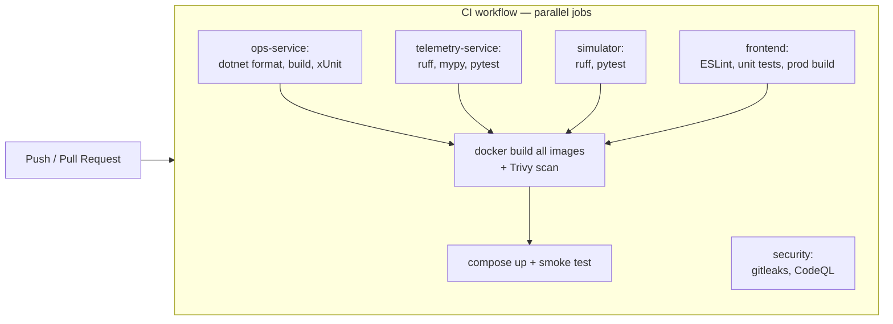
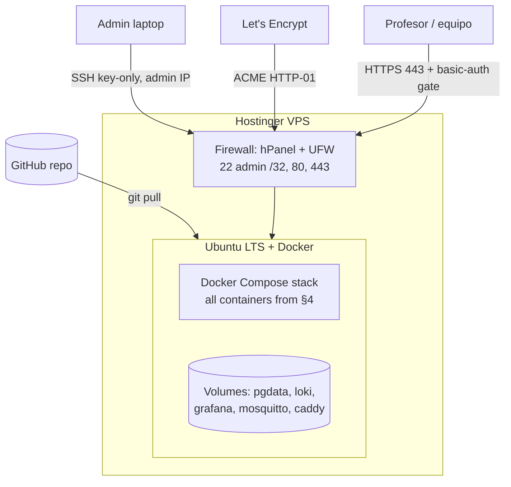

# Architecture — Mérida Flood Monitoring & Early Warning (Alpha Prototype)

> Internal technical doc (English). Source of truth for the diagrams and for the Spanish PDF report.
> Every Mermaid block below is meant to become a polished diagram later.
> Requirements and rubric: see [project.md](project.md). Build plan: see [docs/plan.md](docs/plan.md).

---

## 1. Problem and Scope

**Problem (continued from ADA 4.1 / Data-Driven 4.0 Challenge):** rainwater accumulates in streets and intersections of Mérida, Yucatán, disrupting mobility (pedestrians, cyclists, public transport, drivers, emergency services). Evidence: Gobierno de Yucatán reports (3 Jun 2026) and 134.4 mm recorded at Estación Gobernación (8 Aug 2026).

**Alpha prototype goal:** a running system that:

1. Ingests **simulated** water-depth and rain telemetry from 5 monitoring points over MQTT.
2. Validates, stores and processes it, emulating municipal **ERP/MES** logic (alerts → work orders → crews → resolution).
3. Shows a **real-time, mobile-responsive dashboard** (municipal view + citizen view).
4. Is protected by a **Zero Trust / IDMZ** network design and produces logs consumed by **SIEM detection rules**.
5. Is split into **two microservices** (C# + Python) that communicate through events.
6. Is built, tested and scanned by **GitHub Actions CI**.

**Deployment:** local Docker Compose for development; a single Hostinger VPS (IaaS) for the presentation (§13).

**Explicit non-goals / honesty rules (from ADA 4.1):**

- All sensor data is simulated; it proves the flow and the interface, not predictive accuracy.
- Monitoring points are fictitious and labeled as such.
- Missing data is never converted to zero; it is shown as "no data / stale".
- No automatic road closures or resource dispatch; the system recommends, people decide.

**Design principle:** intentionally over-engineered (microservices, Redis, segmented networks, SIEM stack) **to demonstrate** the architecture concepts of Units 3 and 4. Each component's "why" is stated.

---

## 2. Technology Stack

Exact versions/image tags get pinned at scaffold time (latest stable/LTS).

| Layer | Technology | Why |
|---|---|---|
| Telemetry simulator (OT / field) | **Python** + `paho-mqtt` | The rubric explicitly names "Python script"; emulates 5 field sensors with weather scenarios. |
| Message broker (IDMZ) | **Eclipse Mosquitto** (MQTT, TLS) | Standard IoT protocol; per-device credentials + per-topic ACLs fix the weaknesses found in our Wargame (plain-text creds, no TLS, no topic authorization). |
| **Telemetry Service** (microservice 1) | **Python FastAPI** + `aiomqtt` + SQLAlchemy (async) + asyncpg | Data-heavy side: MQTT ingestion, validation, time-series, status evaluation, KPIs, forecast. Python fits data/analytics. |
| **Operations Service** (microservice 2) | **ASP.NET Core** (.NET 10 LTS) + EF Core + Npgsql | Business side: identity/auth, ERP/MES (alerts, work orders, crews, citizen reports), audit, real-time hub. |
| Real-time push | **ASP.NET Core SignalR** + Redis backplane | Live KPI updates to the dashboard without reload (rubric Excellent level). |
| Inter-service messaging | **Redis Streams** (reliable, consumer groups) + **Redis Pub/Sub** (live fan-out) | Event-driven decoupling between microservices. |
| Database | **PostgreSQL** + **TimescaleDB** extension | Postgres is mandatory; one instance, **one schema + one role per service** (database-per-service pattern). |
| Cache | **Redis** | Latest reading per point, dedup keys, rate-limit counters, KPI cache. |
| Frontend | **Angular** (standalone components, RxJS, `@microsoft/signalr`) | Real-time responsive SPA, municipal + citizen views; RxJS fits streaming data. |
| Charts / map | ECharts (`ngx-echarts`) + Leaflet with OpenStreetMap tiles | Time-series charts, map of points. |
| Edge / API gateway | **Caddy** | HTTPS (local CA now, Let's Encrypt in cloud), security headers, serves the Angular build, routes to each microservice. |
| SIEM-lite / observability | **Grafana + Loki + Promtail** | Centralized logs from broker, services, proxy; LogQL alert rules = SIEM detections. (Wazuh considered: too heavy for one host.) |
| External data | **Open-Meteo API** (real forecast, hourly) | Real weather context next to simulated sensors (source already named in ADA 4.1). |
| Containers | **Docker** + Docker Compose | Every component containerized. |
| CI | **GitHub Actions** | Lint, test, build, scan. CD to cloud added later. |

---

## 3. System Context (C4 Level 1)



---

## 4. Container View (C4 Level 2) — Microservices



### Service boundaries

| Service | Owns (bounded context) | Data | Publishes | Consumes |
|---|---|---|---|---|
| **Telemetry Service** (FastAPI) | Monitoring points, devices, thresholds, readings (raw + clean), point status, KPIs from telemetry, forecasts | schema `telemetry` (role `telemetry_svc`) | `stream:point-status` (status changes, reliable), `events:telemetry` (every clean reading, live) | MQTT `merida/flood/+/+/telemetry` |
| **Operations Service** (ASP.NET Core) | Users/roles/auth, alerts, work orders, crews, citizen reports, audit log, live hub | schema `ops` (role `ops_svc`) | `events:ops` (work order / alert changes) | `stream:point-status` (consumer group `ops`), `events:telemetry`, `events:ops` → SignalR |

Rules: **no service reads another service's schema** (enforced by DB grants). Cross-service data travels in events (event-carried state: events include `pointId`, `pointName`, `zone`, `level`, `depthCm`). The Angular app composes views by calling both services through the gateway.

### Containers

| Container | Responsibility | Exposed on host? |
|---|---|---|
| `caddy` | TLS, HSTS/CSP headers, serves Angular build, routes `/api/telemetry/*`, `/api/ops/*`, `/hubs/*`, `/soc/*` | **Yes: 443 (and 80 → redirect)** |
| `mosquitto` | MQTT broker, TLS, per-identity auth, per-topic ACLs, connection logging | No (internal); 8883 can be opened later for real devices with mTLS |
| `simulator` | 5 virtual stations, scenarios (dry / light rain / storm / sensor fault) | No |
| `citizen-bot` | Simulated citizens: public point status → severity-weighted, rate-bounded reports; same simulator image, no secrets | No |
| `telemetry-service` | MQTT ingest → validate → dedup → persist → Redis latest → status machine → events; REST for points/readings/KPIs; hourly Open-Meteo pull | Only via Caddy |
| `ops-service` | Auth (issues JWT), ERP/MES module, stream consumer, SignalR hub, audit | Only via Caddy |
| `redis` | Streams, pub/sub, SignalR backplane, cache, rate limits, dedup | No |
| `postgres` | System of record, TimescaleDB hypertable for readings | No |
| `promtail`/`loki`/`grafana` | Log collection, SIEM detection rules, SOC dashboard | Grafana only via Caddy, admin-only |
| `attack-sim` (profile `demo`) | Runs six MQTT SIEM scenarios against our own broker; `all` excludes login failures | No |
| `attack-scheduler` (profile `soc-demo`) | Same simulator image; one weighted lab attack every nominal 12 min ±30%; SR-01–05, MQTT only, flood rare, graceful shutdown | No |
| `login-attacker` (profile `soc-demo`) | Same simulator image, no secrets; SR-06 login failures only, every nominal 30 min (minimum 10) ±30%; explicit `ATTACK_SCENARIO=login_failures` runs once | No |

---

## 5. Network Segmentation — Zero Trust + IDMZ

Modeled on the **Purdue model / ISA-IEC 62443** zones and conduits, implemented as isolated Docker networks (and, in the cloud later, a security group mirroring the same allow-list).



**Core rule (IDMZ):** OT and IT **never talk directly**. Both initiate connections *into* the IDMZ broker; there is no route OT ↔ IT. Telemetry is **one-way** (OT → IT): there are **no command topics** to field devices, which removes the "broadcast lock command" attack path from our Wargame.

### Zero Trust principles applied

| Principle | Implementation |
|---|---|
| Never trust the network | TLS on every zone-crossing hop (MQTT 8883, HTTPS 443); Postgres and Redis require credentials even internally. |
| Strong identity per actor | One MQTT identity per device; separate identity for the telemetry service; individual user accounts; MFA (TOTP) for Admin/Supervisor; JWT signed by ops-service (RS256) and verified by each service independently. |
| Least privilege | Topic ACLs per device; one DB role per service limited to its schema; RBAC in both services; containers non-root with dropped capabilities. |
| Microsegmentation | Each container joins only the networks it needs (table below); Postgres reachable only from the two services. |
| Assume breach / verify continuously | Every request re-validates the JWT; auth events, ACL denials and admin actions are logged to Loki and evaluated by SIEM rules. |

### Network membership

| Container | edge_net | app_net | data_net | idmz_net | ot_net | mon_net |
|---|---|---|---|---|---|---|
| caddy | ✔ | ✔ (to services) | | | | ✔ (to grafana) |
| telemetry-service | | ✔ | ✔ | ✔ | | |
| ops-service | | ✔ | ✔ | | | |
| redis | | ✔ | | | | |
| postgres | | | ✔ | | | |
| mosquitto | | | | ✔ | ✔ | |
| simulator | | | | | ✔ | |
| citizen-bot | | ✔ (public HTTP APIs only) | | | | |
| attack-sim / attack-scheduler | | | | ✔ | ✔ | |
| login-attacker | | ✔ (Ops failed logins only; no secrets) | | | | |
| grafana / loki / promtail | | | | | | ✔ |

`data_net`, `idmz_net`, `ot_net` are `internal: true` (no outbound internet). Telemetry service gets egress only for `api.open-meteo.com` (via `app_net` → host; in cloud enforced by egress rules).

### Port / flow matrix (allow-list; everything else denied)

| # | Source | Destination | Port / Protocol | Purpose |
|---|---|---|---|---|
| F1 | Users | caddy | 443/TCP HTTPS, WSS | Dashboard, APIs, SignalR |
| F2 | Users | caddy | 80/TCP | Redirect to 443 only |
| F3 | caddy | telemetry-service | 8000/TCP HTTP (internal) | `/api/telemetry/*` |
| F4 | caddy | ops-service | 8080/TCP HTTP (internal) | `/api/ops/*`, `/hubs/*` |
| F5 | caddy | grafana | 3000/TCP (internal) | SOC console (admin-only) |
| F6 | simulator | mosquitto | 8883/TCP MQTT+TLS | Publish telemetry |
| F7 | telemetry-service | mosquitto | 8883/TCP MQTT+TLS | Subscribe telemetry |
| F8 | telemetry-service, ops-service | postgres | 5432/TCP | Persistence (own schema only) |
| F9 | telemetry-service, ops-service | redis | 6379/TCP (password) | Streams, pub/sub, cache |
| F10 | telemetry-service | api.open-meteo.com | 443/TCP HTTPS | Forecast pull |
| F11 | promtail | Docker log files | read-only mount | Log shipping |
| F12 (cloud, later) | admin IP only | host | 22/TCP SSH (key-only) | Administration |
| F13 | attack-sim, attack-scheduler | mosquitto | 8883/TCP MQTT+TLS | Guarded lab SIEM scenarios, device credentials from files |
| F14 | login-attacker | ops-service | 8080/TCP HTTP (internal) | Failed logins for nonexistent lab account; CSRF header required |

---

## 6. Data Flow — Telemetry to Dashboard (cross-service)



**Telemetry message (MQTT JSON):**

```json
{
  "messageId": "uuid-v4",
  "deviceId": "DEV-P03-A",
  "pointId": "P03",
  "capturedAt": "2026-11-12T20:47:12Z",
  "waterDepthCm": 18.4,
  "rainMm5min": 6.2,
  "batteryPct": 87,
  "fwVersion": "1.2.0"
}
```

**Point-status event (Redis Stream `stream:point-status`):**

```json
{
  "eventId": "uuid-v4",
  "type": "point.status_changed",
  "pointId": "P03",
  "pointName": "Punto simulado P03",
  "zone": "Centro",
  "previous": "Watch",
  "current": "Alert",
  "waterDepthCm": 31.2,
  "occurredAt": "2026-11-12T20:47:12Z"
}
```

**Data quality rules (from ADA 4.1):** schema validation; units and UTC timestamps; range check (depth 0–150 cm, rain 0–100 mm/5min); jump check (> 30 cm/min flagged `suspect`); dedup by `messageId`; stale if no reading in 3 min → `NoData`; raw stored separately from clean; missing ≠ 0; `capturedAt` and `receivedAt` both stored; `suspect` readings never trigger alerts.

---

## 7. Domain Model — ERP/MES Emulation

The "ERP/MES" is emulated as a **municipal operations module** (maintenance / asset management, similar to an EAM/CMMS): monitored assets, events, work orders, crews and SLAs.



Upper group (points, devices, readings, forecasts) = schema `telemetry`. Lower group (alerts, work orders, crews, reports, users, audit) = schema `ops`. `pointId` in `ops` is a reference by value, not a foreign key across services.

### Point status state machine (Telemetry Service)



### Work order lifecycle (Operations Service — ERP emulation)



Priority = f(alert level, point criticality, vulnerable-population flag, citizen report count) — **not** only report count (bias rule from ADA 4.1). SLA timer per priority (Critical 30 min, High 2 h, Medium 8 h); overdue orders highlighted.

---

## 8. APIs

### Roles (RBAC, carried in the JWT `role` claim)

| Role | Can |
|---|---|
| Anonymous / Citizen | Read public point status, submit citizen report (rate-limited, no personal data). |
| Operator | Live dashboard, readings history, validate citizen reports, update work order status. |
| Supervisor | Operator + assign crews, close/cancel orders, edit thresholds. MFA required. |
| Admin | User management, audit log, SOC console. MFA required. |

### Telemetry Service (FastAPI) — via `/api/telemetry`

| Method | Path | Role |
|---|---|---|
| GET | `/public/points` (id, name, zone, lat/lon, status, last depth, last update age) | Anonymous |
| GET | `/points/{id}/readings?from&to&bucket` (Timescale `time_bucket`) | Operator+ |
| GET | `/kpis` (points by status, max depth, rain last 60 min, data freshness) | Operator+ |
| GET | `/points/{id}/forecast` | Operator+ |
| PATCH | `/points/{id}/thresholds` | Supervisor+ |
| GET | `/healthz` | Anonymous (intentional: liveness only) |
| — | OpenAPI docs at `/docs` | disabled in production profile |

### Operations Service (ASP.NET Core) — via `/api/ops`

| Method | Path | Role |
|---|---|---|
| POST | `/auth/login`, `/auth/logout`, `/auth/refresh`, `/auth/mfa/verify` | — |
| GET | `/auth/me` | Authenticated |
| POST | `/public/reports` | Anonymous (rate-limited) |
| GET/PATCH | `/alerts`, `/alerts/{id}` | Operator+ |
| GET/POST/PATCH | `/work-orders`, `/work-orders/{id}` (assign, transition) | Operator+ / Supervisor |
| GET/PATCH | `/reports`, `/reports/{id}` (validate / reject / link) | Operator+ |
| GET/POST | `/crews` | Supervisor+ |
| GET | `/kpis` (open/overdue orders, avg alert→on-site time) | Operator+ |
| GET/POST | `/users` | Admin |
| GET | `/audit` | Admin |
| GET | `/healthz` | Anonymous (liveness only) |
| WS | `/hubs/live` (SignalR): group `public` (point status) and `ops` (everything, authenticated) | — |

### Authentication across microservices

```mermaid
sequenceDiagram
    participant D as Angular
    participant C as Caddy
    participant O as Operations Svc
    participant T as Telemetry Svc
    D->>C: POST /api/ops/auth/login (email, password)
    C->>O: forward
    O->>O: ASP.NET Identity verify (PBKDF2), lockout, MFA if required
    O-->>D: Set-Cookie flood_at=JWT(RS256, 15 min); HttpOnly; Secure; SameSite=Strict
    D->>C: GET /api/telemetry/kpis (cookie + X-Requested-With)
    C->>T: forward
    T->>T: verify JWT signature with ops public key, exp, iss, aud, role
    T-->>D: 200 KPIs
```

- Private signing key only in ops-service (secret); public key mounted read-only in telemetry-service.
- Cookies, not `localStorage` (XSS can't read them). CSRF: `SameSite=Strict` + required `X-Requested-With` header on unsafe methods, checked by both services.
- Refresh token (rotating, stored hashed in `ops`) in a separate HttpOnly cookie scoped to `/api/ops/auth`.

### Dashboard KPIs

Points monitored · points in Watch / Alert / NoData · max depth now · rain last 60 min · open work orders · overdue (SLA) orders · avg response time (alert → crew on site) · data freshness per point.

---

## 9. Redis Usage

| Key / channel | Type | Writer → Reader | Purpose | TTL |
|---|---|---|---|---|
| `stream:point-status` | Stream (consumer group `ops`) | telemetry → ops | Reliable status-change events (at-least-once, idempotent consumer) | MAXLEN ~10k |
| `events:telemetry` | Pub/Sub | telemetry → ops | Every clean reading for live charts | — |
| `events:ops` | Pub/Sub | ops → ops (all replicas) | Alert / work order changes for live push | — |
| SignalR backplane | Pub/Sub | ops ↔ ops | Scale ops-service to N replicas | — |
| `latest:{pointId}` | Hash | telemetry | Last clean reading + status | none |
| `dedup:{messageId}` | String (NX) | telemetry | Idempotent ingestion (QoS 1 redelivery) | 24 h |
| `rl:{ip}:{route}` | Counter | both | Rate limiting (login, citizen reports) | window |
| `cache:kpis:*` | String (JSON) | both | KPI cache | 10 s |
| `forecast:{pointId}` | Hash | telemetry | Latest Open-Meteo forecast | 1 h |

---

## 10. Security Architecture

### Lessons from our Wargame (Escenario C) → controls

| Wargame weakness | Our control |
|---|---|
| Broker credential stored in plain text in a config file | Secrets in a non-committed `.env` / Docker secrets; Mosquitto passwords stored hashed; `.env.example` holds names only. |
| Flat network: guest VLAN reached management host | Microsegmented Docker networks + IDMZ; broker unreachable from the web DMZ. |
| MQTT without TLS | TLS on 8883; plaintext 1883 disabled. |
| No per-topic authorization; any authenticated client could publish a broadcast command | Per-identity ACLs; devices publish only to their own topic; no command topics exist. |
| One identity reused from an unexpected network | SIEM rule SR-01 (identity used from unexpected source). |

### Mosquitto ACL (concept)

```text
# each device publishes only to its own topic
user DEV-P01-A
topic write merida/flood/P01/DEV-P01-A/telemetry
# ... one block per device

# telemetry service reads only telemetry, cannot publish
user svc-telemetry
topic read merida/flood/+/+/telemetry
```

### Controls by layer

| Layer | Controls |
|---|---|
| Gateway | HTTPS only, HSTS, CSP (`default-src 'self'`; `connect-src 'self' wss:`; OSM tile host in `img-src`), `X-Content-Type-Options`, `Referrer-Policy`, `frame-ancestors 'none'`; request size limits; only known paths routed. |
| Services | Input validation (Pydantic models / .NET DTO validation); parameterized SQL (SQLAlchemy / EF Core); RBAC checks in each service (no trust in the gateway); CSRF header check; rate limiting backed by Redis; audit log of privileged actions; generic error responses; OpenAPI/Swagger disabled outside dev. |
| Data | Roles `telemetry_svc` and `ops_svc` own only their schema (each runs its own migrations; telemetry may also USE `public` for TimescaleDB functions); no superuser at runtime; daily `pg_dump` backup (to add with cloud deploy). |
| Containers | Non-root users, `read_only: true` where possible, `cap_drop: [ALL]`, `security_opt: no-new-privileges`, memory/CPU limits, healthchecks, minimal base images, pinned tags. |
| Supply chain | Dependabot, CodeQL, Trivy image scan, gitleaks secret scan; pinned dependency versions (lockfiles). |
| Host (cloud, later) | SSH key-only, no root login, admin IP allow-list, unattended security updates, firewall mirrors the flow matrix. |
| Privacy (ADA 4.1) | Citizen reports ask for no name/address/ID; location refers to the event, not the person. |

---

## 11. SOC Design and SIEM Rules

### Log sources → Loki

| Source | Events of interest |
|---|---|
| Mosquitto | CONNECT/auth success/failure, client IP, ACL denials, disconnects |
| Telemetry Service | Validation failures, duplicates, `suspect` flags, topic/device mismatch, JWT rejections |
| Operations Service | Login success/failure, lockouts, MFA failures, 401/403s, privileged actions (audit), rate-limit hits |
| Caddy | Access logs (IP, path, status, UA) |
| Postgres | Auth failures, permission-denied errors (cross-schema attempts) |

Services log structured JSON (UTC, `event` field, `client_ip`, `user`, `device_id`), so Promtail labels them and Grafana alert rules (LogQL) evaluate them.

### SIEM detection rules

Each rule has **condition, threshold, severity and action** (rubric Excellent level).

| ID | Name | Condition (log source) | Threshold / window | Severity | Action |
|---|---|---|---|---|---|
| SR-01 | Device identity from unexpected source | Mosquitto auth success for a `DEV-*` identity where `client_ip` is not in the OT segment CIDR | 1 event | **Critical** | Alert SOC; revoke device credential; block IP; open incident. |
| SR-02 | MQTT brute force | Mosquitto auth failures from the same IP | ≥ 5 in 60 s | High | Alert; temporary IP ban; review. |
| SR-03 | Unauthorized topic publish | Mosquitto ACL denial (`write` to a topic not owned by the identity) | ≥ 1 in 5 min | **Critical** | Alert; disable identity; investigate compromised device. |
| SR-04 | Telemetry spoofing / flood | Telemetry Svc: messages per device > 5/min (expected 1/min) or `deviceId` ≠ topic owner | per minute | High | Alert; quarantine readings (`suspect`); no flood alerts from them. |
| SR-05 | Physically implausible reading | Telemetry Svc: depth jump > 30 cm in 1 min | 1 event | Medium | Flag reading; notify operator; confirmation before work order. |
| SR-06 | Dashboard credential attack | Ops Svc login failures per IP or per account | ≥ 10 in 5 min | High | Account lockout + alert; rate-limit IP. |
| SR-07 | Privilege misuse | Ops Svc audit: threshold change / order cancel outside 06:00–23:00 or by account < 24 h old | 1 event | Medium | Alert supervisor for review. |

### Example rule in structured form (Sigma-style)

```yaml
title: MQTT device identity authenticated from unexpected network
id: SR-01
status: experimental
description: A field-device MQTT identity authenticated from an IP outside the OT segment. Mirrors Wargame log L2 (pos_fleet_admin from guest VLAN).
logsource:
  product: mosquitto
  category: authentication
detection:
  selection:
    event: auth_success
    username|startswith: 'DEV-'
  filter_ot_segment:
    client_ip|cidr: '172.30.10.0/24'   # ot_net
  condition: selection and not filter_ot_segment
threshold: 1 event
severity: critical
action:
  - notify: soc-alerts
  - revoke_credential: username
  - block_ip: client_ip
falsepositives:
  - Newly provisioned external device not yet added to the allow-list
mitre_attack:
  - T1078   # Valid Accounts
  - T1021   # Remote Services
```

### SOC workflow



**Live demo hook:** `attack-sim` (run only against our own stack) attempts a wrong-password burst, an unauthorized topic publish and a telemetry flood, triggering SR-02, SR-03 and SR-04 in front of the professor.

---

## 12. CI — GitHub Actions



CD (push images to GHCR + deploy to VM with approval + rollback by SHA tag) is designed but **not enabled** until the cloud target is chosen.

---

## 13. Deployment Model

**Local:** `docker compose up` on a developer machine — the same definition that runs in the cloud (Caddy internal CA for `https://localhost`).

**Cloud (presentation): IaaS — one Hostinger VPS (Ubuntu LTS, KVM 2: 2 vCPU / 8 GB), Docker Compose.** Short-lived: deployed for the demo, deleted afterwards. The VPS is shared with other projects, so the host nginx (certbot TLS) proxies our hostname to Caddy on `127.0.0.1:8443`; our stack opens no public ports. Steps: [docs/deploy-vps.md](docs/deploy-vps.md).



**Justification (for the report):**

- **Why IaaS:** 10+ cooperating containers, an MQTT broker with custom TLS/ACLs and a SOC stack. On one VM we control segmentation ourselves (needed to demonstrate the IDMZ), the stack is portable across providers, cost is low and predictable, and local = production (`docker compose`).
- **Trade-offs accepted:** we patch the OS and manage backups; single VM = single point of failure (acceptable for an Alpha); no managed autoscaling.
- **Migration path to PaaS** (connects to ADA 4.1's Azure proposal): each microservice → managed containers (ECS Fargate / Azure Container Apps), Postgres → managed DB, Redis → managed cache, Mosquitto → managed IoT broker (AWS IoT Core / Azure IoT Hub). Microservices + containers make this a lift-and-shift.

---

## 14. Repository Structure

```text
parcial_4t/
├── project.md                   # requirements (English translation)
├── architecture.md              # this file
├── docs/plan.md                 # build plan / task status
├── docker-compose.yml           # full stack
├── .env.example                 # variable names only, no secrets
├── scripts/                     # dev bootstrap: generate certs, secrets, mqtt passwords
├── services/
│   ├── ops-service/             # ASP.NET Core (C#) — Operations microservice
│   └── telemetry-service/       # FastAPI (Python) — Telemetry microservice
├── frontend/                    # Angular app
├── simulator/                   # Python telemetry simulator + attack-sim
├── infra/
│   ├── caddy/Caddyfile
│   ├── mosquitto/               # mosquitto.conf, acl (passwords generated, not committed)
│   ├── postgres/                # init: schemas, roles, Timescale
│   └── observability/           # loki, promtail, grafana provisioning + alert rules
└── .github/workflows/ci.yml
```

---

## 15. Rubric Traceability

| Rubric criterion | Where it is satisfied |
|---|---|
| 1. Backend ingests, processes, persists telemetry, emulating ERP/MES | §4 microservices, §6 data flow, §7 ERP/MES module |
| 1. IaaS/PaaS justification | §13 |
| 1. Legacy and cultural barriers | To write in `docs/` (Ayuntamiento has no public API, manual report channels, paper workflows, staff adoption) — §16 |
| 2. Responsive dashboard, real-time KPIs from backend | §8 KPIs, SignalR §6, Angular responsive |
| 2. Remote supervision + measurable competitive advantage | Mobile operator view, work orders from the phone; KPI "alert → crew on site" time |
| 3. IDMZ segmentation under Zero Trust (microsegmentation, access control, port flow) | §5 diagrams + membership + flow matrix |
| 3. Structured SIEM rule (condition, threshold, severity, action) aligned to real threats | §11 SR-01..07, Sigma example, linked to Wargame |
| 4. PDF 4–5 pages, active repo link, live demo | Handed to teammate; this doc + `docs/` feed it; live demo incl. `attack-sim` |

⚠️ Rubric note: the Excellent level for criteria 1 and 4 expects a **real cloud deployment**; local-only scores "In Development" on criterion 1. Cloud must be done before the presentation.

---

## 16. Open Items

- [ ] Deploy to the Hostinger VPS before the presentation (docs/deploy-vps.md); delete it afterwards.
- [ ] Barrier analysis (technical legacy + cultural) and connected-value write-up (Topics 3.6 / 4.4).
- [ ] Live demo script (6 min) and Q&A prep per team member.

**Known limitations (accepted for Alpha, from security review):** single shared Redis password (per-service Redis ACL users = next hardening step); Grafana `/soc` reachable via gateway with admin login only (restrict by IP/VPN in cloud); access JWT stays valid ≤ 15 min after logout (stateless; refresh tokens are revoked); Promtail runs as root to read the Docker socket; SR-02 counts MQTT auth failures broker-wide (Mosquitto failure lines lack the client IP).
